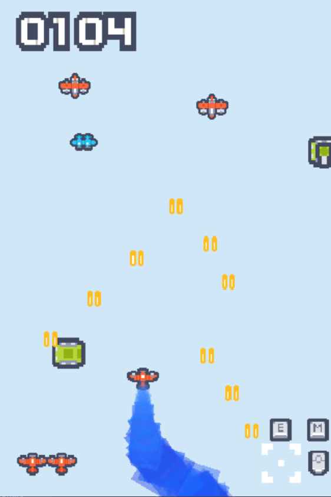

# Plane Game

This is a game built in JavaScript using the LittleJS game engine, deployed through the Vite framework.

The purpose is to demonstrate JavaScript coding syntax, web development and app deployment, and configuration as code via JSON customizations.



## Custom Powerups and Enemies

You can add custom powerups and enemies to the game by adding additional JSON objects to the files in the data folder before building. More documentation on how to build these is coming, but for now just try to match the structure provided in the `default.json` files.

Custom Particle Effects generated [here](https://killedbyapixel.github.io/LittleJS/examples/particles/)

Custom Sounds generated [here](https://killedbyapixel.github.io/ZzFX/)

## Run the game locally

If you've downloaded the code for the game, you can run a local dev version this way:

```bash
npm install
npm run dev
```

Requires Node 22.12+, what the LittleJS package and its tools are tested on.

## Vite commands

```bash
npm run dev       # dev server, the page reloads on save
npm run build     # build to dist/
npm run preview   # preview the production build
```

See the [Vite docs](https://vite.dev) for more.

## Assets

Files in `public/` are served from the site root in dev and copied as-is to `dist/` on build. The tilesheets live there, which is why `engineInit(..., ['tiles.png'])` works in both dev and the built output.

For assets you want Vite to hash and bundle (the usual case for large projects), import them from `src/` instead:

```js
import tilesURL from "./tiles.png";
```

## Deploying

The included `vite.config.js` sets `base: './'`, which makes the built site work from any subdirectory — including GitHub Pages project sites and itch.io uploads. The `public/.nojekyll` file ships in the build so GitHub Pages won't ignore Vite's underscore-prefixed chunk files.

To deploy:

```bash
npm run build
```

then upload the contents of `dist/` (or zip them for itch.io).

## LittleJS

[Read the LittleJS docs to learn more](https://github.com/KilledByAPixel/LittleJS).

## Inspiration

The game was built from the basic principles provided in Eoin McGrath's wonderful [Little-Ski Tutorial](https://eoinmcgrath.com/little-ski/tutorial.html). Check it out for a great step-by-step guide to building your own game with LittleJS!
